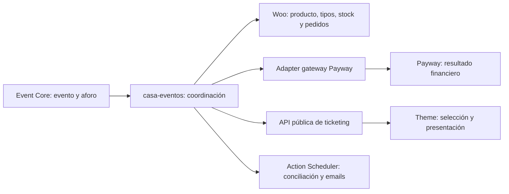

# T0.1 — Propuesta de arquitectura Ticketing V1

**Estado:** CONSOLIDATED / revisión documental 2, 2026-10-12. A9 APPROVED por decisión humana; A1 adoptada y direcciones A2–A8/A10/A13 consolidadas según el task de consolidación. El diseño concreto de tres tablas/lock/fencing sigue siendo candidato; A11/A12 mantienen dependencias abiertas. Nada de comercio está implementado. El estado detallado de §11 prevalece sobre el lenguaje de propuesta de las secciones técnicas.

**Task:** T0.1-CONSOLIDATION-T1-SPEC. Writer documental único en `C:\Projects\la-casa-del-arbol`, branch `main`, base `7aa22adb1a0e740b8a5a588b0363d2291aafc1c9`. Allowlist: este archivo y [especificación T1](t1-ticket-types-spec.md). Estado inicial: solo esta propuesta untracked. Entrega documental sin staging ni commit; no modifica implementación, dependencias, runtime ni roadmap. No inicia T1.

## 1. Autoridad y baseline

Fuentes primarias: [Ticketing V1](ticketing-v1-contract.md), [Casa Eventos](casa-eventos-contract.md), [ownership](content-ownership.md), [roadmap](../project-status.md) y [AGENTS.md](../../AGENTS.md). Los contratos funcionales gobiernan; este documento propone cómo cumplirlos. La división T1–T9 de §10 es una propuesta, no el contenido previamente aprobado de esas fases.

E3.2 aceptado e integrado localmente en `ed98b97e529547912851f88afc5762b037c79853`. D1 informado COMPLETE sobre snapshot histórico; producción actual no verificada y no consultada. Plugin 0.2.0 no identifica por sí solo la revisión instalada. La implementación inspeccionada no contiene comercio: E3.1 aporta `save_event()` sin garantía transaccional; E3.2 aporta UI, nonce y comprobación de estado obsoleto, no locks comerciales.

| Confirmado por contratos / este task | Precisión |
|---|---|
| Un evento, múltiples tipos; precio y stock en Woo | Event Core conserva aforo global, default 100; corte default inicio − 1 hora |
| Checkout directo guest, sin carrito persistente | Un evento por compra, varios tipos del mismo evento; sin merchandising |
| Máximo 10 por compra, ventana de 20 minutos | Este task fija el máximo agregado; el contrato permite máximos menores por tipo |
| Rechazo no extiende reserva | Pago enviado pendiente conserva cupo al vencer el checkout |
| Woo CRUD y HPOS; Payway procesa pagos | No hay gateway, versión ni API seleccionados |
| Confirmación tras pago, recordatorio −24 h, XLSX | Consentimiento newsletter separado; sin QR ni ticket individual |
| Cancelación administrativa, reembolso total | Cancelar evento no reembolsa automáticamente; restitución tras reembolso confirmado |

Las direcciones humanas consolidadas en §11 no aprueban automáticamente todos los detalles técnicos de esta propuesta ni autorizan implementación. Las evidencias externas de §8 no acreditan una instalación ni compatibilidad del proyecto. La especificación T1 separa decisiones confirmadas, elecciones técnicas propuestas y dependencias de fases posteriores.

## 2. Modelo de entidades y ownership propuesto

| Entidad / relación | Fuente de verdad | Integración propuesta |
|---|---|---|
| Evento (`casa_evento`, ID + UUID) | Event Core | Contenido, fechas/zona, modalidad, estado, aforo, corte, venue; sin precio ni stock de tipos |
| Evento 1 ↔ 1 producto variable interno | WooCommerce | Producto virtual, oculto de catálogo/búsqueda, sin envío; el módulo conserva relación única y recuperable en metadata Woo |
| Producto 1 → N variaciones | WooCommerce | Una variación por tipo; nombre, precio, stock restante, activo/inactivo, corte propio, máximo por tipo; sin backorders ni stock compartido del padre |
| Compra 1 → 1 reserva → 0/1 pedido | Coordinación de ticketing / pedido Woo | El pedido se crea antes de pagar, después de admitir reserva; misma compra y pedido para reintentos |
| Pedido 1 → N líneas | WooCommerce | Una línea por variación con cantidad; todas del mismo evento; cantidades sumadas ≤10 |
| Compra 1 → N intentos de pago | Procesador + coordinación | Solo un intento no resuelto a la vez; referencia comercial estable y referencia única por intento |
| Pedido → reembolso total | Woo + evidencia Payway | Refund financiero y restitución coordinados; sin devolución parcial |

El stock Woo es **restante no vendido**, no el cupo inicial. La UI muestra por separado vendido, retenido y disponible. Cambiar el cupo de un tipo se expresa como cambio de dotación total; el servicio calcula el nuevo stock restante y rechaza valores menores que vendido + retenido. No se permite editar directamente stock restante durante ventas. Tipos usados se desactivan, no se borran; UUID del evento no es credencial de acceso.

Snapshots inmutables en pedido/líneas mediante CRUD: versión del esquema, evento ID/UUID, título, inicio local/UTC, zona, venue, variación ID y nombre de tipo, cantidades, moneda, precio unitario, subtotales/impuestos/descuentos/total calculados en servidor y vencimiento original. Billing conserva nombre, apellido, email y teléfono; consentimiento separado con fecha y versión del texto. Nunca almacenar PAN/CVV ni secretos en metadata/logs. Editar evento o tipo no reescribe compras anteriores. Los recordatorios usan la fecha actual del evento; el snapshot registra lo comprado.

Precios en decimal monetario de Woo, nunca floats propios. **Propuesta:** ARS, sin cupones ni cargos propios en V1; configuración fiscal y tratamiento de tipos gratuitos deben aprobarse antes de habilitar ventas. No se inventa una política impositiva. Reservas fijan precio por 20 minutos y pagos ya enviados preservan ese importe; cambio de selección exige reserva nueva y precio actual.

Event Core funciona sin Woo. Un módulo de comercio dentro de casa-eventos carga condicionalmente con dependencias compatibles; expone lectura de tipos/disponibilidad y comandos de compra. Theme presenta datos públicos, sin leer metadata Woo ni decidir elegibilidad. La ampliación de API y de la regla de arquitectura del theme requiere su propio task. Pedidos, pagos y stock transaccional continúan en Woo; tablas auxiliares son coordinación e índices reconstruibles, no un segundo catálogo ni una contabilidad financiera.

## 3. Checkout y disponibilidad

**Propuesta:** checkout de pedido Woo, server-rendered, con formulario de guest y gateway compatible con pago de pedido; evita construir un segundo checkout completo y evita WC cart persistente. No se elige Checkout Blocks. La viabilidad del formulario/gateway y sus validaciones debe demostrarse antes de T3/T4; si exige carrito efímero, volver a review, sin cambiar silenciosamente el modelo.

Inicio mediante POST protegido: validar evento, variaciones pertenecientes, cantidades enteras positivas, máximo agregado 10 y máximos propios, precio y moneda en servidor. No confiar en IDs, total ni disponibilidad del navegador. Hidden catalog no es autorización: denegar add-to-cart, Store API, checkout normal, URL pública de producto y order-pay no autorizado para tickets. No tocar el carrito futuro de productos físicos.

La compra tiene token aleatorio de alta entropía, almacenado como hash, vinculado a sesión guest y reserva; acceso a checkout/status requiere token, sesión y protección CSRF. No usar email, UUID del evento ni order ID como autorización. No exponer tokens en analytics/logs. Checkout y status sin caché compartida; navegación a una página vieja no reabre una reserva.

El reloj servidor UTC fija `expires_at = admitted_at + 1200s`. No se renueva por refresh, doble clic ni rechazo. Al vencer se rechaza todo envío nuevo aunque el worker de limpieza esté atrasado. Cambiar cantidades libera la reserva anterior y vuelve a competir por todas las unidades; no garantiza conservarlas. Los reintentos de transporte con la misma clave devuelven la misma compra, sin renovar plazo. Distintas compras reales pueden tener distintas reservas; una sola compra no puede superar 10.

Sean `C` aforo Event, `S` unidades vendidas no reembolsadas (índice reconciliado con pedidos Woo), `H` unidades retenidas por checkout vigente o pago en curso/no resuelto, `W_i` stock restante Woo del tipo y `H_i` su retención:

`disponible_global = C − S − H`; `disponible_tipo_i = W_i − H_i`.

Admitir solo si `sum(q_i) ≤ disponible_global` y cada `q_i ≤ disponible_tipo_i`. Nunca sumar disponibilidades de tipos para inferir aforo. Conversiones a venta sustituyen H por S sin intervalo de liberación. Un incidente de sincronización bloquea admisión, en vez de usar números inciertos. Cualquier listado es orientativo; el servidor revalida al reservar y al enviar pago.

**Propuesta de cortes:** al enviar pago, comprobar nuevamente estado activo, modalidad tickets, cortes de evento/tipos y reserva vigente. Un corte alcanzado bloquea un envío nuevo aunque queden minutos. Desactivar tipo o pausar evento bloquea envíos nuevos; un intento enviado antes conserva su retención y puede confirmarse. Cancelación tiene tratamiento especial en §5. No extender el reloj por fallas de red.

## 4. Protocolo de reservas, concurrencia y recuperación

### 4.1 Diseño candidato; implementación no aprobada

La dirección consolidada A2/A3 exige un único coordinador autoritativo de stock/reservas y enforcement atómico demostrable del aforo. No aprueba las tres tablas, el mecanismo de lock/fencing ni la supresión concreta de hooks Woo descritos abajo. Evaluarlos en T2 antes de elegir implementación; T1 solo define el modelo y una frontera para el futuro coordinador, con ventas cerradas.

Coordinar por evento mediante tablas InnoDB propias: (1) `commerce_event` con fila única/evento, versión y fence de operación pendiente; (2) `purchase` con clave idempotente única, hash del payload, token hash, líneas normalizadas en payload versionado, pedido único, vencimiento, estado y versión; (3) `operation` con intentos, recibos de callbacks y efectos locales, claves únicas y fases de recuperación. No crear entidad por entrada individual. Los nombres son conceptuales, sin migraciones en T0.1.

Solo SQL parametrizado sobre estas tablas propias; productos/pedidos por APIs Woo. El índice de compras vendidas es proyección de pedidos, no autoridad del pago. Cada operación registra evidencia para conciliarlo; una discrepancia congela nuevas ventas del evento. No prometer que `WC_Order::save()` o hooks externos participan de una transacción SQL propia.

Se prefiere una retención coordinada para ambos límites a duplicar reservas con expiraciones diferentes. **Propuesta:** excluir únicamente pedidos de tickets del hold/auto-cancel/reduce/restock automáticos de Woo que compitan con el coordinador; no modificar su comportamiento para otros productos. Stock efectivo se descuenta/restaura con APIs Woo bajo coordinación. El adapter debe impedir que callbacks o cambios de estado reduzcan/restauren stock por segunda vez. Si un gateway no permite hacerlo, es incompatible con esta propuesta hasta revisión.

La reserva nativa Woo es una alternativa evaluada, no elegida: opera por producto y contempla vencimiento/status; no acredita por sí sola el aforo global ni retención de pago pendiente sin plazo. Véase [ReserveStock](https://woocommerce.github.io/code-reference/files/woocommerce-src-checkout-helpers-reservestock.html). Reusar dos motores requeriría garantizar que ambos caducan y se recuperan juntos; un producto extra de aforo agregaría stock duplicado y líneas artificiales.

### 4.2 Admisión atómica

1. Abrir transacción corta, bloquear `commerce_event` con `SELECT … FOR UPDATE`; crear esa fila de forma idempotente si falta. Lock order fijo: evento → compra → operaciones; IDs de tipos ordenados. Espera limitada y reintento acotado ante deadlock; falla sin reserva parcial.
2. Rechazar si existe fence de mutación/recuperación. Leer valores frescos del Event/Woo (sin confiar en objetos previamente cacheados). Todos los cambios comerciales de ese evento deben adquirir el mismo lock; no hay modificaciones externas concurrentes autorizadas.
3. Expirar lógicamente compras abandonadas vencidas sin intento en curso; contar pagos pendientes aunque `expires_at` sea pasado. Validar reglas y ambos límites para el vector completo.
4. Insertar una compra con todas las líneas y vencimiento; unique idempotency key evita dos reservas. Misma clave + mismo payload devuelve resultado original, incluso expirado; distinta carga con misma clave devuelve conflicto. Commit. No crear pedido ni llamar red dentro de este lock.
5. Reclamar operación de creación de pedido con fence durable antes de CRUD Woo. Persistir referencia de compra en pedido, snapshots y vínculo. No habilitar pago hasta que el vínculo sea consistente. Si el proceso muere tras crear pedido y antes de vincularlo, recovery busca por referencia vía Woo, adopta uno y anula duplicados no pagables; no vuelve a crear a ciegas. La compra retiene cupo hasta vencer/reconciliar; ningún pedido huérfano puede cobrar.

La operación completa no es una transacción distribuida. La admisión de unidades sí es indivisible; la persistencia Woo se recupera con pasos durables. Un error sin evidencia completa no se anuncia como éxito.

### 4.3 Mutaciones Woo y fences

Antes de reducir/restaurar stock, registrar bajo lock una operación con lista de tipos, cantidades y valores frescos antes/después esperados; fijar fence del evento y conservar ocupación. Commit antes de efectos Woo. Un worker único aplica CRUD/APIs stock, registra progreso por línea y verifica persistencia. Cerrar operación bajo lock, cambiar retención/venta y retirar fence solo cuando el pedido y todos los stocks sean consistentes. Una conversión puede bloquear brevemente todo el evento; V1 privilegia seguridad sobre throughput.

Mientras haya fence, otras reservas, cambios de cupo, lifecycle comercial y workers del mismo evento esperan o fallan; no toman una lease vencida como prueba de que el worker dejó de operar. Recuperación requiere comprobar que no hay worker activo y conciliar efectos. Si murió entre stock write y marca de progreso, comparar estado Woo fresco con antes/después bajo el fence; aplicar solo efectos demostrablemente faltantes. Un resultado ambiguo, edición externa o varias líneas parcialmente aplicadas mantienen el evento bloqueado para revisión. Nunca repetir incremento/decremento sin evidencia.

Los markers de stock Woo ayudan pero no reemplazan atomicidad demostrada. T2 debe demostrar recuperación con fallas en cada frontera; si APIs/hooks/cache de la versión elegida impiden establecerla, rediseñar antes de habilitar ventas. No escribir directamente tablas internas de stock/pedidos para esquivar CRUD.

### 4.4 Edición y expiración

Reducción de aforo necesita mismo lock y restricción `nuevo C ≥ S + H`; cambiar stock de tipo exige `nuevo cupo_i ≥ vendido_i + H_i`. Cubrir UI E3.2, REST, editor administrador, revisiones y herramientas Woo capaces de alterar datos comerciales. El filtro `casa_eventos/validate_event` sirve para mensaje, pero **no** garantiza exclusión mutua entre validación y persistencia. Hooks posteriores `event_cancelled`/`schedule_changed` tampoco cierran esa carrera: se necesita comando comercial que abarque lectura, validación y escritura, con integración mínima aprobada en Core. Scripts externos/importaciones no coordinados quedan fuera de la operación permitida; discrepancias obligan a bloquear y conciliar.

Expiración: comparación de reloj en cada comando + worker Action Scheduler, no solo cron. Worker ejecuta transición con lock/versión; no libera `submitting` ni `payment_pending`. Si el proceso cae antes de enviar red, recovery distingue un intento nunca enviado de resultado desconocido; liberar requiere evidencia de no cobro posible. Caída de scheduler puede retrasar limpieza/emails, pero no permite reutilizar checkout vencido ni sobreventa.

## 5. Matriz de estados y pago propuesto

La compra mantiene estado explícito; Woo status es proyección operacional, no prueba financiera ni reloj de checkout. Pago requiere evidencia autenticada Payway y concordancia de comercio, pedido/intento, importe y moneda. Retorno del navegador nunca confirma pago.

| Origen / hecho | Destino compra | Proyección Woo | Stock / aforo y efectos |
|---|---|---|---|
| Reserva admitida, pedido preparado | `checkout_active` | `pending` | H retenido por 20 min; stock Woo sin reducir |
| Enviar antes de plazo/corte | `submitting` | `pending` | Intento durable previo a red; H retenido, no segundo envío |
| Aceptado pendiente o timeout incierto | `payment_pending` | `on-hold` | H sin expiración automática; consultar procesador |
| Rechazo definitivo antes de plazo | `checkout_active` | `pending` | Intento `failed`, mismo H y reloj; puede intentar otra vez |
| Rechazo definitivo tras plazo | `failed` | `failed` | Liberar H una vez; checkout inutilizable |
| Abandono con plazo vencido y sin pago en curso | `expired` | `cancelled` | Liberar H una vez; nueva compra desde evento |
| Pago exitoso autenticado de intento retenido | `paid` | `completed` para virtual | H → S y reducir W por línea una vez; email después de conciliar |
| Cancelación de evento sin intento enviado | `cancelled` | `cancelled` | Liberar H; denegar checkout nuevo |
| Cancelación con intento pendiente | `payment_pending` + cancel flag | `on-hold` | Retener H; solicitar anulación si soportada, sin asumir éxito |
| Éxito pendiente tras cancelar evento | `paid` + refund required | `completed` + metadata/incidente | H → S; no entrada válida ni recordatorio; administrador gestiona reembolso |
| Solicitud administrativa de refund total | `refund_pending` | Mantener status pagado | S sigue ocupado; no restock por solicitud |
| Refund rechazado/timeout | `paid` o `refund_pending` incierto | Mantener status pagado | No liberar S ni reintentar cobro inverso a ciegas |
| Refund total verificado y registrado | `refunded` | `refunded` | Restituir W y liberar S exactamente una vez; vender solo si evento elegible |
| Éxito contradice cierre definitivo ya liberado | `payment_exception` | Estado financiero real + incidencia | No admitir acceso ni ocupar sobre cupo; conciliación/manual refund, sin auto-refund |

`submitting`, `payment_pending`, `refund_pending` e incidencias son estados de coordinación; no requieren crear nuevos Woo statuses en V1. Mantener separado resultado de cada intento. Un rechazo antiguo no revierte un éxito; refund confirmado es irreversible por notificaciones de pago anteriores. Doble cobro inesperado se registra como incidencia de importe extra, sin duplicar unidades ni emails.

**Propuesta para pagos tardíos:** éxito de intento válidamente enviado y aún retenido convierte la misma reserva aunque hayan pasado 20 minutos o el corte; no constituye compra nueva. No liberar por timeout arbitrario. Consultar hasta estado terminal o intervención administrativa con evidencia de cierre. Un pago exitoso después de haber liberado por evidencia terminal contradictoria no se reasigna automáticamente, aun si queda disponibilidad: requiere resolución financiera humana. Así no se vende por encima de C ni se oculta dinero cobrado.

**Propuesta para cancelación pendiente:** la venta está bloqueada inmediatamente, pero el pago en vuelo puede existir. Comunicar resultado financiero y evento cancelado sin email de acceso válido; reembolso manual. Un refund solicitado o desconocido no devuelve cupo. Un refund confirmado fuera de Woo solo admite registro manual después de verificar referencia e importe completo; ese comando ejecuta la misma restitución una vez. No existe botón de marcar reembolsado como sustituto de esa evidencia.

## 6. Idempotencia y efectos externos

- Claves únicas persistidas: inicio de compra (session/key + payload hash), creación de pedido (purchase ID), envío (attempt ID), callback (gateway + event ID, o transaction/status/version normalizados si falta event ID), refund (order + operación), conversión/restock por línea. Cambiar payload con clave usada es conflicto.
- Callback autenticado se registra durablemente antes de responder éxito HTTP; comprobar firma o verificación server-to-server documentada, identidad del comercio, referencia, importe/moneda y replay. Sin mecanismo demostrable no se acepta gateway. Recibo repetido retorna éxito sin efectos nuevos; lock + versión de compra arbitran callbacks diferentes sobre el mismo pago. Notificación fuera de orden provoca consulta de estado, no transición regresiva.
- Persistir `submitting` antes de red, llamar fuera de lock y resolver bajo lock. No enviar otro intento mientras el anterior sea desconocido. Idempotencia del procesador o consulta por referencia es requisito; timeout no permite volver a cobrar usando un ID nuevo.
- Operaciones financieras y emails quedan en cola durable (operation + Action Scheduler); workers usan claves únicas y vuelven a comprobar estado. Fallo después del efecto externo y antes de marcarlo exige reconciliación. Nunca prometer exactly-once de red sin soporte externo.
- Confirmation email se deduplica por pedido; cancelación por pedido/evento; reminder por pedido/evento. Marcar aceptación del transporte. Para timeout SMTP ambiguo no reenviar automáticamente: incidente para revisar, pues SMTP no garantiza envío único. Proveedor con idempotencia sería mejora independiente, no dependencia instalada aquí.
- Logs estructurados con IDs/estado/código y evidencia mínima; sin tokens, datos de tarjeta, credenciales ni payloads personales íntegros. Retención de auditoría y PII requiere política antes de release.

## 7. Contratos de integración operativa

**HPOS:** `WC_Order`, `WC_Order_Item_Product`, `WC_Order_Refund`, `wc_get_order`, `wc_get_orders`/query APIs y CRUD de metadata; sin `shop_order` postmeta/SQL propios. Producto/variación también vía Woo APIs. No asumir que HPOS vuelve atómico un flujo. Declarar compatibilidad solo después de auditoría y checks de la versión fijada en almacenamiento HPOS y legacy; gateway incluido. Fuente: [HPOS recipe book](https://developer.woocommerce.com/docs/features/orders/high-performance-order-storage/recipe-book/).

**A9 APPROVED — decisión humana del task de consolidación:** administrador y Programador pueden crear/modificar tipos, precios y cupos desde Eventos mediante capabilities comerciales explícitas y estrechas. Cada comando verifica autorización en servidor, capability de la operación y autorización sobre el evento concreto; resolver variaciones desde su padre autorizado impide usar IDs de otro evento. El calendario institucional compartido de E1.1 se conserva: no se impone propiedad por autor.

La propuesta técnica T1 nombra `manage_casa_ticket_types`, `edit_casa_ticket_prices` y `edit_casa_ticket_capacities`, combinadas con `current_user_can( 'edit_post', event_id )`; los nombres son diseño de implementación, no permisos ya instalados. Nonce protege transporte, no sustituye autorización. No otorgar `manage_woocommerce`, `edit_products` ni permisos de pedidos genéricos al Programador. Finanzas, gateway, refunds y conciliación permanecen administrador-only y fuera de T1. Acceso a compradores/export del A9 original no queda aprobado por extensión: permanece propuesta para T7.

Editar precio no modifica snapshots de reservas/pedidos existentes; tipos usados se preservan. Reducir aforo/cupo nunca puede dejarlo debajo de vendido + retenido. Si ese consumo no puede comprobarse, denegar reducción; T2 deberá garantizar la comprobación y escritura atómicas bajo ventas. T1 no finge contadores cero ni implementa el coordinador candidato. Detalle de rutas, UI y aceptación en [T1](t1-ticket-types-spec.md). Cancelación/reactivación conserva permisos E3.2 y no ejecuta refund automático.

**Emails:** reutilizar sistema Woo/email templates; una confirmación específica con identidad, contacto, evento, fecha/zona, venue, cada tipo/cantidad, total y referencia, suprimiendo duplicados genéricos solo para tickets. Scheduler propone reminder a inicio actual −24 h, verifica pedido pagado no reembolsado y evento no cancelado. Reprogramación cancela trabajo antiguo y programa nuevo; si ya se envió, no repetir reminder. Propuesta para compra dentro de últimas 24 h: solo confirmación, sin reminder retroactivo. Cambio de fecha después de envío requiere comunicación administrativa separada. Cancelación detiene recordatorios; entrega SMTP y cron confiable son dependencias operativas de release.

**XLSX:** una fila por línea de pedido (varios tipos generan varias filas); nombre/apellido, email, teléfono, tipo, cantidad, número pedido, pago, fecha compra y columna manual de ingreso. Default listado de accesos pagados vigentes; filtro explícito para otros estados financieros, claramente rotulados. Download autenticado, generación temporal privada o streaming, sin URL pública permanente; strings tipados para impedir fórmulas/inyección y límites de memoria/paginación. Proponer una biblioteca XLSX mantenida tras evaluar compatibilidad/licencia; no elegir ni instalar ahora. No persistir marcas de ingreso.

## 8. Payway: matriz de requisitos y evidencia

Fuentes oficiales consultadas el 2026-10-12: [soluciones online Payway Argentina](https://www.payway.com.ar/soluciones-pago-vender-online), [venta online](https://www.payway.com.ar/vender-online) y [portal developers Argentina](https://developers.payway.com.ar/). Las páginas comerciales ofrecen WooCommerce y API/SDK; el portal público no proporcionó en esta inspección un contrato técnico legible suficiente. No usar documentación del homónimo payway.com. No se inspeccionó paquete, sandbox ni cuenta comercial; **ningún candidato está certificado compatible**.

| Requisito | Evidencia actual | Gate de selección / prueba futura |
|---|---|---|
| Canal Woo/API disponible | Oferta pública oficial | Identificar proveedor/mantenedor, paquete exacto, versión, licencia, soporte y changelog |
| PHP/WP/Woo/HPOS y pago de pedido guest | No acreditado | Matriz del candidato + código auditado + sandbox con versiones fijadas |
| Tokenización/hosted fields/redirect | No acreditado | Tarjeta fuera de servidor LCDA; documentar flujo y obligaciones de integración |
| Referencia e idempotencia de envío | No acreditado | Doble request/timeout produce un solo cargo; consulta por referencia si respuesta perdida |
| Callback autenticado y consulta de pago | No acreditado | Método verificable documentado; intento/comercio/importe/ARS vinculados; replay rechazado |
| Pendiente y confirmación tardía | No acreditado | Lista de estados terminales/no terminales; latencias, polling, reintentos y conservación de cupo |
| Evitar stock/auto-cancel/email duplicados | No acreditado | Puntos de extensión que permiten coordinador único, incluidos status automáticos del gateway |
| Anulación y refund total | No acreditado | Diferenciar anulación/refund, límites/plazos, referencia e idempotencia; fallo no restituye stock |
| Pruebas y operación | No acreditado | Alta comercio, credenciales sandbox fuera de repo, datos de prueba, HTTPS endpoint de prueba autorizado |
| ARS, medios, cuotas y liquidación | No definido técnicamente | Acordar medios V1 y total final; no agregar cuotas/recargos sin decisión de producto |

Priorizar gateway mantenido si satisface todos los gates; adapter delgado normaliza resultados y entrega coordinación, sin desarrollar procesador propio. Si ningún candidato cumple, presentar costo/alcance de adapter API para aprobación; no asumir compatibilidad por un logo Woo o por declarar HPOS.

Evidencia Woo adicional: [stock functions](https://github.com/woocommerce/woocommerce/blob/trunk/plugins/woocommerce/includes/wc-stock-functions.php) y [ReserveStock](https://woocommerce.github.io/code-reference/files/woocommerce-src-checkout-helpers-reservestock.html), referencias públicas consultadas en la fecha indicada, no una versión seleccionada. Revalidar contra release exacta antes de implementar. Observaciones: Woo posee mecanismos de reserva/reducción/restauración; la integración debe evitar dobles efectos. Esto no demuestra el protocolo propio ni su compatibilidad futura.

## 9. Escenarios de aceptación futuros

Son criterios para implementación posterior, **no pruebas ejecutadas**. Comprobar estado de compra, pedidos/operaciones, stock por tipo, aforo, llamadas gateway y mensajes; no basta revisar UI.

| Escenario | Resultado requerido |
|---|---|
| C=100, S=70, H=8; pedir 23 | Rechazo total, sin pedido pagable ni retención parcial |
| Queda 1 global; dos checkouts simultáneos en tipos distintos | Solo uno admitido, aunque ambos stocks individuales tengan unidades |
| Quedan 2 de tipo A; dos compras piden 2 cada una | Solo una; ninguna sobreventa ni stock negativo |
| Mezcla A=6+B=5 / A=6+B=4 | Primera rechazada por 11; segunda admitida solo si ambos límites y máximos propios permiten |
| Doble clic / misma key en paralelo | Una compra/reserva/pedido; mismo resultado y reloj; payload distinto produce conflicto |
| Abandono y worker atrasado | A los 20 min checkout no paga; una nueva admisión excluye hold vencido bajo lock |
| Envío y expiración simultáneos | Serialización: envío válido retiene, o expiración impide enviar; nunca ambos |
| Rechazo en minuto 19; retry minuto 21 | Rechazo no renovó plazo; segundo envío denegado |
| Timeout tras enviar / éxito minuto 35 | No liberar ni cobrar de nuevo; una consulta/callback convierte H→S una vez |
| Callback duplicado o fallo posterior a éxito | Una reducción/confirmación; ninguna regresión de estado |
| Callback falso o importe/moneda discordante | No confirmar ni liberar; registrar incidente sin revelar datos |
| Éxito después de liberación por estado terminal contradictorio | Incidencia financiera sin acceso ni sobreaforo; resolución administrativa |
| Cancelación concurrente con reserva/envío | Cancelación bloquea nuevos comandos; intento previo conserva H hasta terminal; no auto-refund |
| Pago confirma tras cancelación | Dinero registrado, sin acceso/reminder, refund requerido visible |
| Refund total duplicado / callback repetido | Una restitución por línea y aforo; sin email/importe duplicados |
| Refund falla o respuesta desconocida | Unidades siguen vendidas; consulta antes de retry; no falso éxito |
| S=70, H=8; bajar C a 77 / 78 | 77 bloqueado; 78 permitido con lock; carrera con reserva no invalida límite |
| Reducir cupo de tipo bajo vendido+retenido | Rechazo también desde REST/admin, no solo UI |
| Caída tras admitir / crear pedido / debitar una línea | Recuperación sin nueva reserva/cargo; fence bloquea ventas hasta conciliación |
| Woo/adapter ejecuta reducción automática adicional | Check falla; candidato no puede habilitar ventas |
| Cambio de fecha/refund previo al reminder | Trabajo obsoleto no envía; pedido inválido excluido; nunca reminder duplicado |
| Export por usuario no autorizado / nombre comienza con '=' | Acceso denegado; celda literal, sin fórmula; sin archivo público |

T2/T4/T5 necesitan pruebas de integración con conexiones concurrentes y fallas reales sobre entorno local autorizado y versiones fijadas; no el viejo harness de bootstrap. Este task no crea infraestructura para ejecutarlas.

## 10. Límites propuestos T1–T9

| Fase propuesta | Scope / entrega mínima | Gate y frontera |
|---|---|---|
| T1 | Modelo Woo: vínculo único, tipos/precios/cupos, contrato de snapshots, APIs internas y UI E3.2 con A9 | Scope en [T1](t1-ticket-types-spec.md); versión Woo de QA y autorización de implementación/runtime en su task. Sin pedidos/reservas/checkout/pagos; ventas deshabilitadas. Fiscalidad/gateway no bloquean modelo con configuración explícitamente pendiente |
| T2 | Elegir coordinador; reserva atómica, expiración, guards de cupo y recuperación | Tres tablas/lock/fencing son candidato, no mandato aprobado; demostrar carreras/fallas; sin Payway real ni emails |
| T3 | Selección de varios tipos y checkout de pedido guest; token, total, límite 10 y aislamiento de carrito | Gate de viabilidad pago-de-pedido; sin habilitar venta pública |
| T4 | Gateway elegido y adapter, envío/callback/query, estados y conciliación | Evidencia §8 y sandbox autorizado; sin acceso a producción |
| T5 | Cancelación con pago pendiente y refund total administrativo, recuperación y restitución | Evidencia financiera + una sola mutación de stock; sin auto-refund |
| T6 | Confirmación, cancelación y reminder con scheduler y deduplicación | Transporte y política últimas 24 h aprobados; sin newsletter integration |
| T7 | Compradores, XLSX privado, capacidades y resumen operativo básico | Writer XLSX y permisos aprobados; sin check-in/analytics avanzados |
| T8 | Integración visual/API Home/Agenda/Single y estados de venta | Cambios mínimos de contratos/architecture checker; no lógica comercial en theme |
| T9 | QA integrada V1: concurrencia, fallas, HPOS/legacy y sandbox; paquete de evidencia | Sin producción ni deployment implícitos; V1-R/V1-D/V1-Q mantienen tasks y gates propios |

Cada fase incluye sus checks pertinentes; T9 no posterga seguridad/concurrencia hasta el final. T4 discovery puede preceder T3 para decidir formulario compatible, sin iniciar integración por este documento. No cambiar secuencia canónica hasta aprobación del plan.

## 11. Estado de decisiones tras consolidación humana

| ID | Dirección consolidada | Estado / límite de aprobación |
|---|---|---|
| A1 | Un producto Woo variable por evento, una variación por tipo; preservar tipos usados e historia | ADOPTED por dirección humana. Pedidos/snapshots se materializan en fases posteriores |
| A2 | Coordinador único y enforcement atómico de capacidad demostrable | REQUIRED. Tres tablas/lock/fencing: CANDIDATE, no implementación aprobada |
| A3 | Una autoridad coordina stock/reservas y evita efectos duplicados | REQUIRED. Hooks/adapter/mecanismo y pruebas de recuperación pendientes antes de ventas |
| A4 | Checkout directo guest, sin carrito persistente; máximo agregado 10 | PRESERVED. Checkout de pedido es candidato condicionado al gateway |
| A5 | Snapshots de precio al reservar y revalidación | PRESERVED, subordinado a Ticketing V1. Detalle de cortes/cambio de selección no redefine el contrato |
| A6 | No liberar pago enviado pendiente por el reloj de checkout | PRESERVED. Conciliación y manejo de excepciones obligatorios antes de habilitar pagos; SLA/cadencia pendientes |
| A7 | Cancelación no implica devolución ni liberación de pago pendiente | PRESERVED. Resultado financiero y refund manual deben conciliarse antes de liberar cupo |
| A8 | Pago tardío contradictorio requiere excepción/conciliación | PRESERVED. Sin acceso automático ni sobreaforo; resolver operativamente antes de release de pagos |
| A9 | Administrador y Programador crean/modifican tipos, precios y cupos con capabilities estrechas | APPROVED explícitamente. Servidor + evento; finanzas/gateway/refunds/conciliación administrador-only. Lectura PII/export de propuesta anterior pendiente para T7 |
| A10 | Una confirmation y un reminder elegible, con idempotencia | PRESERVED. Política de compra <24 h/reprogramación sigue propuesta, no nueva decisión aprobada |
| A11 | Configuración de precio/moneda sin inventar fiscalidad | UNRESOLVED: taxes, moneda comercial definitiva, tipos gratis, medios/cuotas. ARS/sin cupones del borrador no se elevan a aprobado |
| A12 | Gateway, compatibilidad, credenciales y biblioteca XLSX | UNRESOLVED; matriz §8 sin candidatos certificados. No bloquea configuración administrativa T1 con ventas cerradas |
| A13 | Mantener límites T1–T9, permitir discovery Payway temprano | PRESERVED como dirección; cada implementación conserva task propio. Responsables, cron/mail y retención siguen pendientes antes de release |

La exigencia anterior de aprobar todas las dependencias de §11 antes de T1 se reemplaza explícitamente: A11/A12 y el mecanismo candidato A2/A3 no bloquean el modelo administrativo sin ventas. El task T1 deberá autorizar código y, separadamente, la preparación del LocalWP descartable si necesita Woo. No iniciar T1 ni hacer commit por este documento.

## 12. Compatibilidad con contratos existentes

- A9 reemplaza la restricción administrador-only de tipos/precios de esta propuesta. No contradice §14 de Casa Eventos: acceso Woo general sigue prohibido al Programador; las capabilities comerciales nuevas aún no existen. El texto histórico de §14 enumera el rol implementado, no el futuro rol T1. Su actualización documental deberá acompañar la implementación.
- Ticketing V1 §5 describe tandas activadas manualmente por el administrador; la decisión humana A9 amplía explícitamente esa operación al Programador autorizado. No se altera cancelación, reactivación, pedidos ni refunds. No se interpreta como aprobación del acceso a compradores/export del borrador.
- A1 concuerda con Ticketing V1 §6 y Casa Eventos §1: precio/stock en Woo, aforo/estado en Event Core. No duplicar stocks en meta Event ni sumar stocks para determinar aforo.
- La regla 2 de `tests/check-architecture.php` inspeccionada prohíbe referencias Woo en todo el plugin, aunque el contrato exige independencia de Event Core. T1 deberá delimitar su excepción al módulo comercial y mantener prohibición en Core/theme; no desactivar el check globalmente. Regla 1 también debe distinguir metadata Woo vía CRUD de `_casa_*` editorial; usar prefijo comercial propio evita abrir acceso a meta Event.
- T1 no implementa `S + H` real ni atomicidad de reservas; no puede certificar capacidad bajo ventas. Toda ocupación desconocida bloquea reducciones y toda compra queda denegada hasta T2/T3 y gates de pagos. No reutilizar el fingerprint E3.2 como lock.
- El roadmap conserva autoridad y no se cambia a T1 IN PROGRESS. E3.2 local y D1 informado no acreditan Woo ni runtime del entorno descartable.
